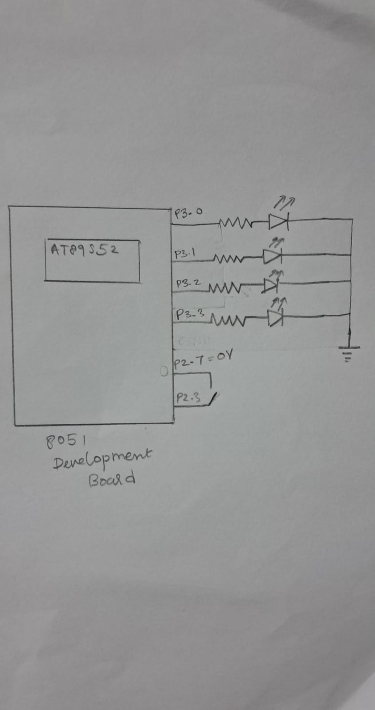

# CAT3 – Timer-Based LED Pattern Generator and Button Interrupt Controller

## EXP

CAT3

## DATE

27/07/2026

## NAME OF EXP

Timer-Based LED Pattern Generator and Button Interrupt Controller

## HARDWARE SETUP / PLATFORM

- **Development Board:** 8051 Development Board
- **Microcontroller:** AT89S52
- **CPU Core:** 8051-compatible 8-bit microcontroller core
- **Programming Environment:** Keil µVision
- **Programming Language:** Embedded C
- **LED Connections:**
  - LED1 – P3.0
  - LED2 – P3.1
  - LED3 – P3.2
  - LED4 – P3.3
- **Push Button Connections:**
  - P2.7 – Used to drive the button/keypad line LOW
  - P2.3 – Used to detect the button press (active LOW)
- **External Components:** Four LEDs, current-limiting resistors and a push button

## TASK NO

**Task: Timer-Based LED Pattern Generator and Button Interrupt Controller**

1. Configure four LEDs as digital outputs using direct GPIO register access.
2. Configure a push button as a digital input.
3. Implement four LED operating modes:
   - Mode 1 – Running LED Pattern
   - Mode 2 – 4-bit Binary Counter
   - Mode 3 – Alternating LED Pattern
   - Mode 4 – All LED Flash
4. Detect button presses and advance to the next operating mode.
5. Implement switch debouncing so that one physical press produces one state transition.

## Circuit Diagram

## Core Logic / Pseudocode / Code Base

The program uses direct port-pin access through the `reg51.h` header file to control four LEDs connected to Port 3 and detect a push-button input through Port 2.

A global variable `count` stores the current operating mode. It ranges from 0 to 3, corresponding to the four LED modes.

**Working principle:**

1. Initialize P2.7 as the button/keypad driving line and P2.3 as the button input.
2. Continuously check the value of `count` using a `switch` statement.
3. Execute the corresponding LED mode.
4. During the software delay, check whether the button is pressed.
5. When an active-LOW button press is detected, increment `count` and use modulo 4 to cycle through the four modes.
6. Wait for the button to be released before continuing.

**Four operating modes:**

- **Mode 1 – Running LED Pattern:** LEDs turn ON sequentially from LED1 to LED4.
- **Mode 2 – Binary Counter:** The four LEDs display binary values from `0000` to `1111`.
- **Mode 3 – Alternating Pattern:** LED2 and LED4 turn ON together, followed by LED1 and LED3.
- **Mode 4 – All LED Flash:** All four LEDs turn ON together and then turn OFF together.

**Code Base:**

The implementation is written in Embedded C using the 8051 register definition header file `reg51.h`. Separate functions are used for the software delay and each of the four LED operating modes.

The button is checked through polling inside the delay function. The current implementation uses nested software loops for timing.

## INFERENCE

The experiment demonstrates register-level GPIO control using the AT89S52 microcontroller. Four LEDs are controlled through Port 3, while a push button connected to Port 2 is used to change the operating mode.

The program demonstrates four different LED patterns: sequential LED running, binary counting, alternating LEDs and simultaneous LED flashing. A software delay function is used to control the timing of the LED patterns.

The implementation demonstrates direct hardware control without using Arduino APIs, HAL libraries or RTOS services. The current implementation uses button polling and software delays rather than hardware timer interrupts or an external button interrupt.
